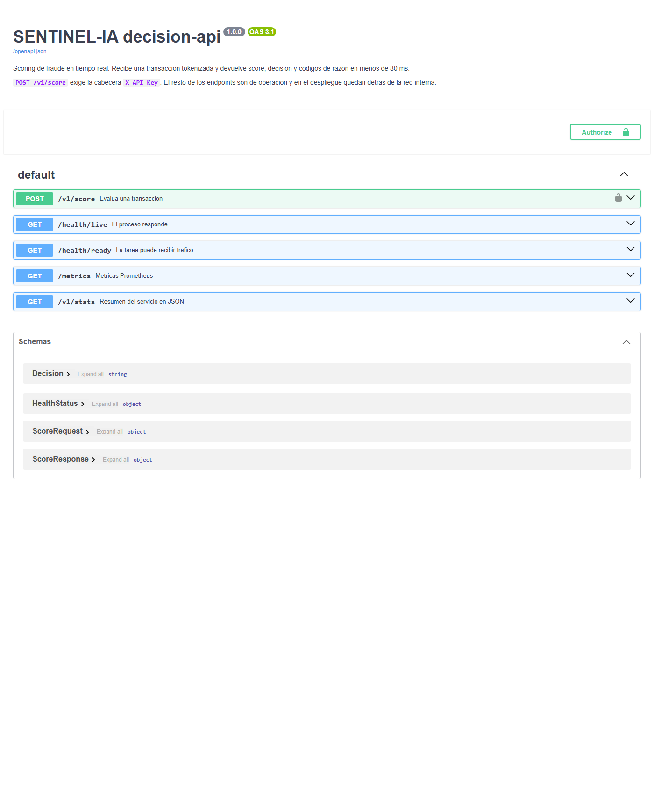
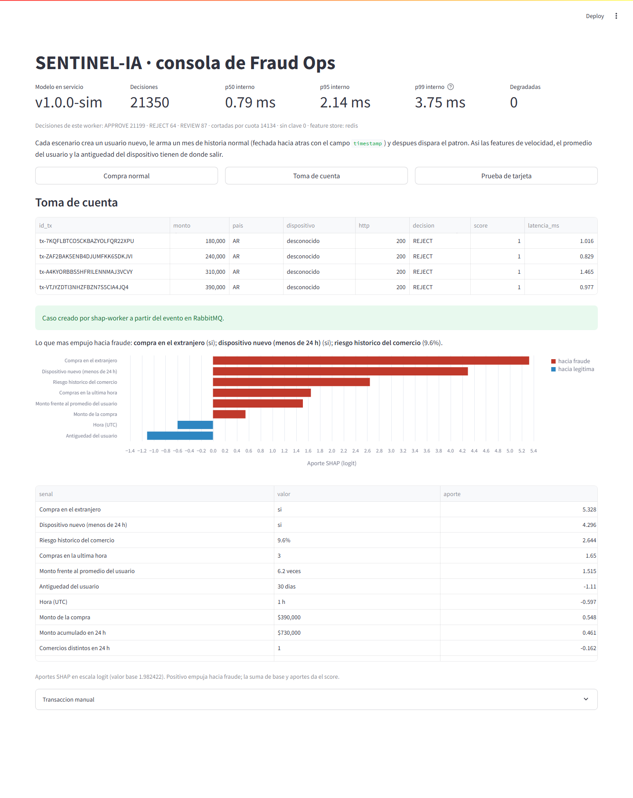
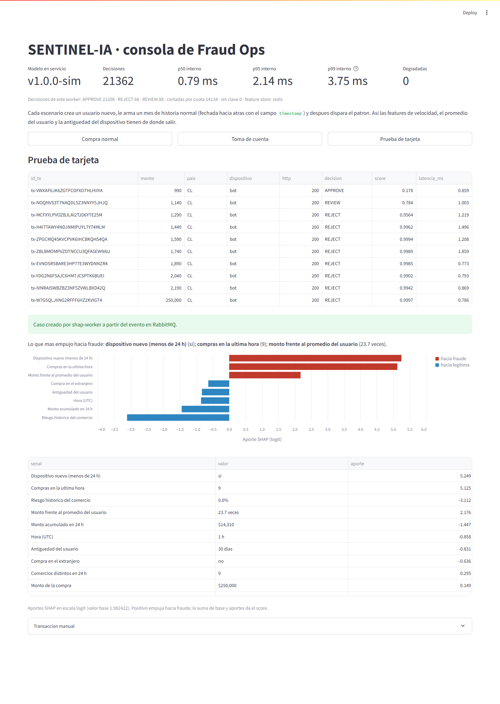
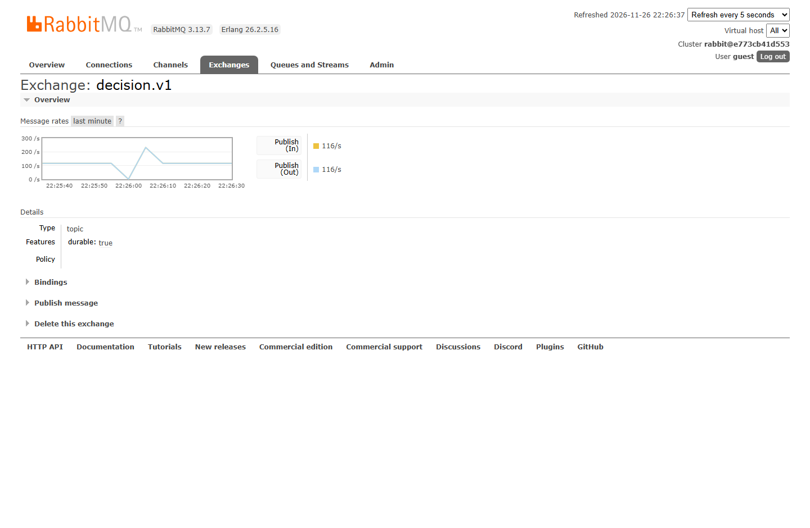

<!--
BORRADOR del informe tecnico de la EP3 (pauta: PDF de 10 paginas).
Todo lo que esta entre [COMPLETAR: ...] depende de AWS o de datos del equipo.
Las cifras salen de docs/RESULTADOS.md y de los archivos de docs/evidencias/:
si se vuelve a medir, actualizar ambos.
Nombre del PDF: EP3_Equipo7_Martinez_Farenden_PenayLillo_Pavon.pdf
-->

# SENTINEL-IA · Evaluación Parcial 3

**Proyecto integral de despliegue y optimización de un sistema de IA empresarial**
Caso 3: detección de fraude financiero

Equipo 7: [COMPLETAR: nombres completos de Martínez, Farenden, Peña y Lillo y Pavón]
ITY1102 Arquitectura de Sistemas de Inteligencia Artificial · [COMPLETAR: sección y docente] · [COMPLETAR: fecha de entrega]
Repositorio: https://github.com/kuroishi-py/sentinel-ia

---

## Correspondencia con la pauta

| Apartado de la pauta | Indicador | Sección |
|---|---|---|
| 2.1 Implementación y despliegue del modelo; interpretabilidad; capturas | IE1, IE2 | 2 |
| 2.2 Flujo entre componentes; seguridad (autenticación, TLS, rate limiting); secuencia e interoperabilidad | IE7 | 3 |
| 2.3 Casos de prueba; latencia p50/p95/p99, throughput y errores; carga; métricas del modelo; optimización | IE10 | 4 |
| 1.2 Escalabilidad y costos | IE4, IE5 | 4.4 y 5 |
| Aspectos formales: referencias APA y declaración de uso de IA | — | Final |

**Retroalimentación de entregas anteriores.** [COMPLETAR: observaciones del
docente a la EP2 y cómo se incorporaron. En la EP1 no hubo observaciones.]

---

## 1. Qué se construyó

SENTINEL-IA califica cada transacción de la pasarela de pagos antes de
autorizarla y responde aprobar, revisar o rechazar en menos de 80 ms. Los casos
dudosos llegan a Fraud Ops con su explicación. El diseño (EP1 y EP2, arc42 y
C4) fijó los objetivos que esta entrega mide:
- p99 bajo 100 ms en la pasarela y bajo 30 ms dentro del servicio (RNF1);
- 116 tx/s de pico (RNF4);
- explicación de cada rechazo (RNF5);
- menos falsos positivos que el 40% del motor de reglas actual (RNF7).

La implementación sigue los componentes de la EP2. Donde cambió algo, el
cambio se justifica con una medición:

| Componente (EP2 §5) | Implementación EP3 | Equivalente en AWS (EP2) |
|---|---|---|
| decision-api | FastAPI + XGBoost en memoria, gunicorn con 2 workers | ECS Fargate, 3 a 12 tareas |
| Feature store | Redis 7.4: perfil, contadores 1 h/24 h, dispositivos e idempotencia | ElastiCache Valkey |
| Bus de eventos | RabbitMQ 3.13, exchange `decision.v1` | Kinesis |
| shap-worker | Consume `decision.v1`, TreeSHAP, crea el caso | ECS |
| Consola de Fraud Ops | Streamlit | React sobre Nginx |
| Borde | Caddy: TLS 1.3 | NLB + ALB con mTLS |

Todo se levanta con `docker compose up`.

---

## 2. Implementación y despliegue del modelo (2.1)

### 2.1 Tipo, framework y por qué

Clasificador binario de gradient boosting, **XGBoost 2.1.3** (Chen y Guestrin,
2016), como decidió la EP2 (D1): sobre datos tabulares iguala o supera a una
red neuronal, predice en menos de 1 ms en CPU y admite TreeSHAP exacto
(Lundberg et al., 2020).

### 2.2 Datasets: dos modelos, a propósito

El equipo enfrentó un conflicto (issue #1 del repositorio). El dataset público
con fraude real, *Credit Card Fraud* de la ULB (Dal Pozzolo et al., 2015), trae
sus features anonimizadas como componentes principales (`V1`-`V28`). Un modelo
entrenado con ellas tiene métricas reales, pero:
- no se puede servir, porque la pasarela no envía componentes principales;
- su explicación SHAP («V14 aportó 0,31») no ayuda a ningún analista a decidir.

Se optó por dos modelos con roles distintos:

| | Modelo de servicio | Benchmark real |
|---|---|---|
| Rol | Responde `/v1/score` y se explica en la consola | Mide el algoritmo sobre fraude real |
| Datos | Historia simulada: 4.000 usuarios, 300 comercios, 70 días, 315.503 tx, 0,60% fraude | ULB: 284.807 tx, 0,17% fraude |
| Features | Las 11 del diseño, con nombre | `Amount`, `V1`-`V28` |
| Partición | Temporal: 21 días de referencia, 35 de entrenamiento y 14 de prueba | Estratificada 80/20 |

La historia simulada contiene tres patrones de fraude: toma de cuenta, prueba
de tarjeta y cuenta nueva. También contiene comportamientos legítimos que se
les parecen, para que el problema no sea trivial: viajes al extranjero, cambio
de celular, compras grandes, rachas de compras y pasajes de montos chicos.

**La decisión clave es cómo se calculan las features.** El entrenamiento
reproduce la historia por la misma función que usa la API en producción
(`compute_features`), sobre el mismo feature store en versión de memoria. Así,
la restricción RT2 (*feature parity*) se cumple por construcción. Es la fuente
más común de fallas silenciosas en sistemas de ML en producción (Sculley et al.,
2015). La prueba CP-20b la verifica: reproduce cada transacción por la ruta
validada de la API y exige features idénticas.

### 2.3 Entrenamiento e hiperparámetros

- **Hiperparámetros:** `max_depth` 6, `eta` 0,1, `subsample` 0,8,
  `colsample_bytree` 0,8, `min_child_weight` 5, método `hist`.
- **Desbalance:** `scale_pos_weight` = 166,1 (legítimas sobre fraudes).
- **Parada temprana:** sobre los últimos 7 días del período de entrenamiento;
  el conjunto de prueba no se mira hasta el final. Resultado: 299 rondas.
- **Riesgo por comercio:** tasa de fraude con suavizado bayesiano, calculada
  solo con el período de referencia, para que la feature no filtre la etiqueta.
- **Restricciones monotónicas** (EP2 §8.2, control contra evasión AML.T0015):
  más velocidad, más monto sobre el promedio, un dispositivo nuevo, una compra
  en el extranjero o un comercio riesgoso nunca bajan el score.
- **Artefacto:** se publica con su SHA-256; la API no carga un modelo alterado
  (CP-21).
- **Reproducibilidad:** semilla fija; el modelo sale idéntico bit a bit en la
  misma plataforma.

Las métricas están en la sección 4.3.

### 2.4 Despliegue

**Local (verificado).** El endpoint `POST /v1/score` corre detrás de un borde
TLS 1.3 en `https://localhost:8443`:
- la API carga el modelo y verifica el SHA-256;
- hace un *warm-up*;
- solo entonces responde 200 en `/health/ready`, porque el balanceador de la
  EP2 (menos solicitudes pendientes) no admite *slow start*.

La imagen es multietapa sobre `python:3.12-slim`, con usuario sin privilegios
y sin secretos. Swagger se publica en `/docs` (Figura 1).

**AWS SageMaker.** [COMPLETAR: endpoint Serverless Inference: configuración,
memoria, concurrencia, captura de la consola, logs y métricas `Invocations` /
`ModelLatency` de CloudWatch. El repositorio deja preparado
`src/training/sagemaker_deploy.py` y documenta en `docs/EVIDENCIAS.md` (nota del
issue #3) el camino para desplegar el modelo de servicio sin training job.]



### 2.5 Integración en la aplicación empresarial e interpretabilidad

La API nunca devuelve la explicación a la pasarela; la EP2 lo prohíbe para
dificultar la extracción del modelo. El camino es asíncrono:
1. Cada decisión se publica en RabbitMQ.
2. shap-worker calcula TreeSHAP solo para revisiones y rechazos.
3. El worker crea el caso con el valor de cada feature y su aporte.
4. La consola de Fraud Ops lo muestra en el lenguaje del analista.

En la Figura 2, una toma de cuenta termina rechazada y la consola explica por
qué:
- compra en el extranjero (aporte +5,3);
- dispositivo visto por primera vez hace menos de 24 h (+4,3);
- comercio con 9,6% de fraude histórico (+2,6);
- tres compras en la última hora, por 6,2 veces el promedio del usuario.

La antigüedad del usuario, de 30 días, empuja en contra (−1,1). TreeSHAP es
exacto: la suma del valor base y los aportes da el score (CP-22).



La Figura 3 muestra la prueba de tarjeta:
- la primera sonda, de $990, se aprueba;
- la segunda va a revisión;
- desde la tercera se rechaza.

La delata la velocidad (9 compras en la última hora) junto con el dispositivo
nuevo, no el monto. Esa distinción se ganó corrigiendo un sesgo: la primera
versión del simulador rechazaba un pasaje de micro desde un celular nuevo
(sección 4.5).



---

## 3. Integración de servicios (2.2)

### 3.1 Flujo entre componentes distribuidos

El camino síncrono sigue la Figura 6 de la EP2. El único agregado es la
autenticación al inicio:

1. **Borde (Caddy).** Termina TLS 1.3 y reenvía a decision-api por la red
   interna. No expone `/metrics` ni `/v1/stats`.
2. **decision-api.** Autentica la API key y aplica la cuota del cliente.
   InputGuard rechaza cualquier campo con forma de número de tarjeta (Luhn).
   IdempotencyGuard (SET NX en Redis) devuelve la misma decisión para un
   `id_tx` repetido.
3. **Features.** Una sola pipeline a Redis lee el estado del usuario (ventanas
   de 1 h y 24 h, perfil y dispositivos) y lo actualiza con la transacción
   actual: una ida y vuelta de red, como presupuesta la EP2.
4. **Modelo y política.** XGBoost en memoria y PolicyEngine: listas negras,
   piso de monto y botón de pánico. Si se agotan 60 ms, la respuesta sale
   degradada antes del timeout de 80 ms de la pasarela.
5. **Fuera de la ruta crítica.** El evento `decision.v1` se publica desde un
   hilo aparte, con búfer de 10.000 eventos. Publicar nunca bloquea el pago.
6. **shap-worker.** Consume la cola `shap.cases` (durable, enlazada al
   exchange `decision.v1`), explica y crea el caso, que la consola lee.

Durante la prueba de carga, RabbitMQ registró 116 mensajes/s de entrada y de
salida en `decision.v1` (Figura 4). Hubo 16.704 eventos publicados y 0
descartados.



**Degradación, no caída.** La EP2 (§8.5) exige que una falla de un componente
no corte pagos:

| Falla | Respuesta del sistema |
|---|---|
| Redis no responde | La decisión sale degradada y nunca se aprueba a ciegas (CP-07) |
| Falla la idempotencia | La transacción se evalúa como nueva (CP-19). Antes devolvía 500: lo encontró la prueba de carga |
| RabbitMQ caído | El evento espera en el búfer y se reintenta |
| No hay modelo | Todo va a revisión humana |

### 3.2 API REST y documentación

| Endpoint | Uso | Acceso |
|---|---|---|
| `POST /v1/score` | Decisión sobre una transacción (RF1, RF2, RF3, RF9) | Pasarela, con API key |
| `GET /health/live`, `GET /health/ready` | Health checks del balanceador | Público |
| `GET /metrics` | Métricas Prometheus | Red interna |
| `GET /v1/stats` | Resumen JSON con p50, p95 y p99 para la consola | Red interna |
| `GET /docs`, `GET /openapi.json` | Swagger y contrato OpenAPI 3.1 | Público |

### 3.3 Seguridad

- **Autenticación.**
  - Cada cliente tiene una API key, enviada en `X-API-Key` y comparada en
    tiempo constante. Sin clave válida: 401 con `WWW-Authenticate`.
  - Las claves viven en variables de entorno, nunca en el código ni en la
    imagen.
  - En AWS, la EP2 usa mTLS en el ALB; la identidad del certificado cumple el
    mismo papel.
  - [COMPLETAR si se despliega: mTLS en el ALB.]
- **Encriptación TLS.**
  - El borde solo negocia TLS 1.3 (Rescorla, 2018) y rechaza TLS 1.2.
  - Envía HSTS, `X-Content-Type-Options: nosniff` y oculta la cabecera
    `Server`.
- **Rate limiting.**
  - Token bucket por cliente autenticado (200/s sostenidas, ráfaga de 400).
  - Quien no se autentica también tiene cuota, así que probar claves tiene un
    límite.
  - Bajo 857 req/s ofrecidas por un solo cliente, la API respondió 26.357 veces
    429 con `Retry-After` y ninguna vez 5xx.
- **Otros controles de la EP2 implementados:**
  - rechazo de PAN por Luhn (el sistema queda fuera del alcance PCI-DSS);
  - SHA-256 del modelo;
  - restricciones monotónicas;
  - contenedores sin root.

Todo se verifica con `scripts/verificar_seguridad.py`:

```
[OK] Version TLS negociada - TLSv1.3, TLS_AES_128_GCM_SHA256
[OK] TLS 1.2 rechazado - TLSV1_ALERT_PROTOCOL_VERSION
[OK] Sin API key -> 401 - 401 ApiKey
[OK] API key valida -> 200
[OK] HSTS - max-age=31536000
[OK] /metrics no se ve desde afuera - 404
```

### 3.4 Diagrama de secuencia y pruebas de interoperabilidad

La secuencia es la Figura 6 de la EP2. [COMPLETAR: insertar la figura, con el
paso de autenticación agregado antes de InputGuard.]

La interoperabilidad se prueba con el sistema levantado (CP-23, seis pruebas),
por el mismo camino que usaría la pasarela:
- el borde negocia TLS 1.3 y rechaza 1.2;
- los endpoints de operación no se ven desde afuera;
- sin clave no se pasa;
- una toma de cuenta termina en un caso explicado, con las features de Redis;
- una compra normal no genera caso;
- RabbitMQ tiene la cola enlazada y un consumidor activo.

Las seis pasan.

---

## 4. Testing y calidad (2.3)

### 4.1 Casos de prueba

Son 24 casos (CP-01 a CP-23 y CP-20b) en 101 funciones: 95 unitarias y de
integración, que corren sin Docker, y 6 de punta a punta. Todas pasan, y ruff
no reporta hallazgos. La integración continua del repositorio corre las 95 con
un Redis real en cada cambio.

| Grupo | Casos | Qué verifican |
|---|---|---|
| Guardrails | CP-01 a CP-04 | Rechazo de PAN por Luhn, idempotencia, datos corruptos en el store |
| Política | CP-05 a CP-08 | Umbrales, reglas que solo endurecen, degradadas a revisión, botón de pánico |
| Cuota | CP-09, CP-10, CP-17 | Token bucket por cliente, relleno, 429 con `Retry-After` |
| Features | CP-11, CP-20, CP-20b | Orden del vector, ventanas 1 h/24 h, paridad Redis/memoria y entrenamiento/servicio |
| API | CP-13 a CP-16 | Contrato, PAN en caliente, idempotencia, health y métricas |
| Seguridad y resiliencia | CP-18, CP-19 | API key, fuerza bruta con cuota, Redis caído sin 500 |
| Modelo | CP-21, CP-22 | Artefacto aprobado, comportamiento, monotonía, SHAP exacto |
| Interoperabilidad | CP-23 | TLS → API → Redis → RabbitMQ → worker → caso |

### 4.2 Rendimiento a 116 tx/s

**Cómo se midió:**
- Carga durante 3 minutos dentro de la red de Docker y contra la tarea
  (gunicorn con 2 workers), como lo haría el balanceador.
- Antes, la historia de 20.000 usuarios se precarga en Redis. Sin ella, cada
  solicitud parece una cuenta nueva desde un dispositivo nuevo y no representa
  el pico real.
- El entorno es una VM de Docker de 2 vCPU compartida, así que las cifras son
  un piso.

| Herramienta | Solicitudes | Throughput | p50 | p95 | p99 | Errores |
|---|---|---|---|---|---|---|
| k6, llegada constante | 20.881 | 116,0 req/s | 1,84 ms | 2,63 ms | **4,51 ms** | 0% |
| Locust (`FastHttpUser`) | 20.600 | 115,0 req/s | 44 ms | 88 ms | 120 ms | 0% |
| Servidor, solicitud completa | — | — | 1,56 ms | 2,22 ms | **3,57 ms** | — |

**Objetivos de la EP2:** p99 en la pasarela < 100 ms, p99 interno < 30 ms y
errores < 1%. Los tres se cumplen con amplio margen, sin decisiones degradadas
y con 99,4% de aprobaciones.

Locust mide unos 40 ms más que k6. La diferencia es del cliente, no del
servicio:
- el servidor mide 1,6 ms en la misma corrida;
- una sonda independiente en paralelo mide 3,9 ms;
- Locust con un usuario mide 3 ms, y en saturación (más solicitudes por
  conexión), 2 ms.

El costo aparece con más de 100 conexiones casi ociosas en el cliente Python
de Locust, sobre esta VM. Se reportan las dos herramientas: Locust porque la
pauta lo pide, y k6 porque mide lo que vería la pasarela.

### 4.3 Métricas del modelo

Medidas sobre los 14 días de prueba, que el modelo nunca vio: 70.732
transacciones, 510 fraudes.

| | Precision | Recall | F1 | PR-AUC | FP sobre legítimas |
|---|---|---|---|---|---|
| Modelo, umbral de rechazo 0,80 | 0,871 | 0,831 | 0,851 | 0,918 | 0,09% (63) |
| Modelo, umbral de revisión 0,45 | 0,796 | 0,875 | 0,834 | 0,918 | 0,16% (114) |
| Motor de reglas, mismos datos | 0,070 | 0,941 | — | — | 9,1% (6.396) |
| Benchmark ULB (real), 0,80 | 0,872 | 0,837 | 0,854 | 0,879 | 0,02% (12) |

Notas de lectura:
- **Accuracy (0,998) no se usa.** Con 0,6% de fraude, aprobar todo da 0,994.
  Por eso se reportan precision, recall y PR-AUC, que es más informativa que
  ROC con clases desbalanceadas (Saito y Rehmsmeier, 2015).
- **Contra el motor de reglas:** de cada 100 alertas, el motor tiene 93 falsas
  y el modelo 13. El costo es recall: 0,83 contra 0,94 al umbral de rechazo.
  Por eso existe el umbral de revisión, que recupera 0,875 con un analista en
  el medio.
- **Por tipo de fraude** (umbral 0,45): cuenta nueva 0,965, toma de cuenta
  0,871 y prueba de tarjeta 0,858. Lo que se escapa es lo que se diseñó
  difícil: tomas de cuenta «lentas y bajas» y desde el celular del propio
  usuario.
- **Benchmark real:** el mismo algoritmo obtiene precision y recall del mismo
  orden sobre fraude real. Eso respalda que el resultado del modelo de servicio
  no es un artefacto de la simulación.

[COMPLETAR, opcional: Figura con la vista «Calidad del modelo» de la consola,
`docs/evidencias/03_dashboard_calidad_modelo.png`.]

### 4.4 Escalabilidad: capacidad de una tarea

La EP2 supuso 120 solicitudes/s por tarea de 1 vCPU con p99 < 30 ms, y dejó
escrito «se valida en prueba de carga». Se midió limitando el contenedor a 1
vCPU y subiendo la tasa con k6:

| Tasa | 120 | 250 | **375** | 500 | 800 |
|---|---|---|---|---|---|
| p99 | 5,2 ms | 7,0 ms | **25,4 ms** | 64 ms | 285 ms |

**La capacidad real es de unas 375 solicitudes/s: tres veces lo supuesto.**
Con 3 tareas mínimas (una por zona), el pico de 116 tx/s queda a menos de un
noveno de la capacidad. Si cae una zona, las dos restantes atienden 58 req/s
cada una, un sexto de su capacidad.

### 4.5 Lo que encontraron las pruebas

Las pruebas de carga, las de comportamiento del modelo y la revisión del código
encontraron problemas que las unitarias no veían. Todos se corrigieron y la
mayoría quedó cubierta por un caso:

| Problema | Corrección |
|---|---|
| Un timeout de Redis en la idempotencia devolvía 500 con la decisión ya calculada | Ahora degrada (CP-19) |
| XGBoost abría un hilo OpenMP por núcleo en cada predicción; con 2 workers en 2 vCPU, el p99 interno llegaba a 62 ms | Un hilo por proceso: 3,5 ms |
| El script de carga original generaba unas 730 req/s llamándolas «el pico», y contaba los 429 como éxitos | Perfiles `pico` y `capacidad`; los 429 van en su propia fila |
| El simulador hacía que el modelo rechazara pasajes de micro desde un celular nuevo | Se corrigieron los datos y se reentrenó |
| Las features de velocidad del esqueleto no tenían ventanas reales | Ventanas reales en Redis (CP-20) |

**Riesgo vigente:** un `id_tx` numérico de 13 a 19 dígitos tiene cerca de 10%
de probabilidad de pasar Luhn y ser rechazado como si fuera un PAN. El contrato
con la pasarela debe fijar identificadores no numéricos.

### 4.6 Oportunidades de optimización

1. **Ajustar el escalado a la capacidad medida.** El objetivo por tarea puede
   pasar de 40 a ~120 req/s, y el máximo de 12 tareas sobra (4 cubren 1.000
   tx/s). Las 3 mínimas se mantienen por disponibilidad.
2. **Probar tareas de 0,5 vCPU.** El pico de una zona son 39 req/s. Hay que
   medirlo antes de cambiarlo; si funciona, baja el costo de la API de decisión
   (USD 173,59/mes en el Anexo F).
3. **Cuota compartida.** El token bucket es por proceso, así que el límite
   efectivo de una tarea con 2 workers es el doble. Un límite exacto por
   cliente en toda la flota requiere Redis o WAF.
4. **SHAP por lotes** en shap-worker, para absorber picos de revisiones con
   menos CPU.
5. **Umbral de rechazo como decisión de negocio.** Pasar de 0,80 a 0,90 evita
   18 de 63 falsos positivos a cambio de 10 de 510 fraudes, con F1 casi igual.

---

## 5. Costos

La estimación de la EP2 (Anexo F, AWS Pricing Calculator, sa-east-1) es de USD
1.982/mes para 1.000.000 tx/día: 4,8% del fraude anual que el caso busca
contener. Las mediciones de esta entrega no la contradicen y la mejoran en un
punto: la API necesita menos capacidad que la supuesta (sección 4.4).
[COMPLETAR: costo real del endpoint de SageMaker durante la demostración.]

---

## 6. Conclusiones

[COMPLETAR por el equipo. Ideas que sostienen los datos:]

- El diseño de la EP2 cumple sus objetivos medidos. La decisión de servir el
  modelo en memoria (D2) deja el p99 en 4,5 ms, frente a 100 ms de presupuesto.
- La interpretabilidad depende del contrato de features más que del modelo.
  Por eso se separó el modelo que se sirve del que se usa como benchmark.
- Las pruebas de carga y de comportamiento encontraron problemas que las
  unitarias no veían, y validaron (y corrigieron al alza) el supuesto de
  capacidad de la EP2.

---

## Referencias

Chen, T., & Guestrin, C. (2016). XGBoost: A scalable tree boosting system. En *Proceedings of the 22nd ACM SIGKDD International Conference on Knowledge Discovery and Data Mining* (pp. 785-794). https://doi.org/10.1145/2939672.2939785

Dal Pozzolo, A., Caelen, O., Johnson, R. A., & Bontempi, G. (2015). Calibrating probability with undersampling for unbalanced classification. En *2015 IEEE Symposium Series on Computational Intelligence* (pp. 159-166). IEEE. https://doi.org/10.1109/SSCI.2015.33

Lundberg, S. M., Erion, G., Chen, H., DeGrave, A., Prutkin, J. M., Nair, B., Katz, R., Himmelfarb, J., Bansal, N., & Lee, S.-I. (2020). From local explanations to global understanding with explainable AI for trees. *Nature Machine Intelligence, 2*(1), 56-67. https://doi.org/10.1038/s42256-019-0138-9

Rescorla, E. (2018). *The Transport Layer Security (TLS) protocol version 1.3* (RFC 8446). Internet Engineering Task Force. https://doi.org/10.17487/RFC8446

Saito, T., & Rehmsmeier, M. (2015). The precision-recall plot is more informative than the ROC plot when evaluating binary classifiers on imbalanced datasets. *PLOS ONE, 10*(3), e0118432. https://doi.org/10.1371/journal.pone.0118432

Sculley, D., Holt, G., Golovin, D., Davydov, E., Phillips, T., Ebner, D., Chaudhary, V., Young, M., Crespo, J.-F., & Dennison, D. (2015). Hidden technical debt in machine learning systems. En *Advances in Neural Information Processing Systems 28* (pp. 2503-2511).

---

## Declaración de uso de IA generativa

[REVISAR por el equipo antes de entregar.] Se utilizó Claude (Anthropic) para:
- revisar el repositorio frente a la pauta de la EP3;
- implementar el simulador de transacciones, el cálculo de features compartido
  entre entrenamiento y servicio, la autenticación y el borde TLS;
- escribir pruebas;
- ejecutar y diagnosticar las pruebas de carga;
- redactar borradores de la documentación y de este informe.

Las decisiones de diseño provienen de la EP1 y la EP2 del equipo. Las cifras
reportadas fueron medidas en el sistema y están respaldadas por los archivos de
`docs/evidencias/`. El contenido final fue revisado y validado por el equipo.
