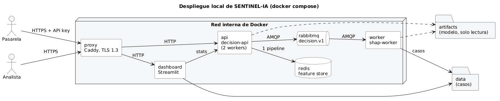
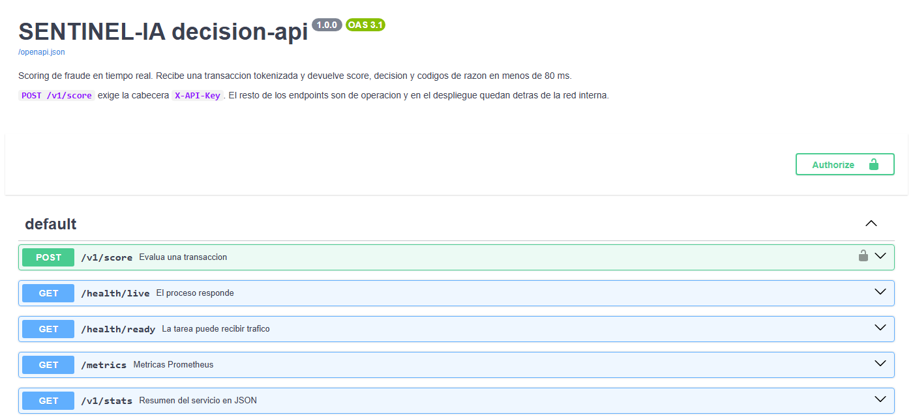
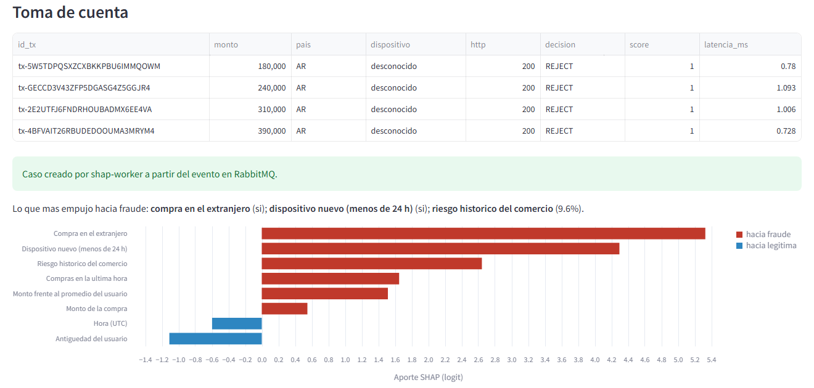
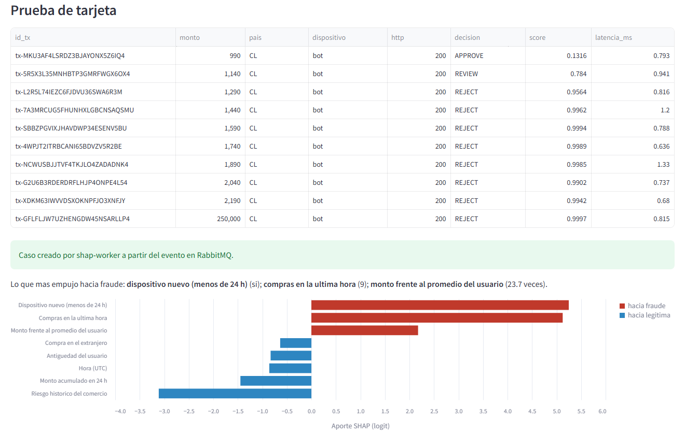
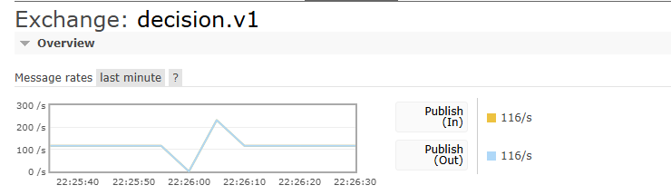
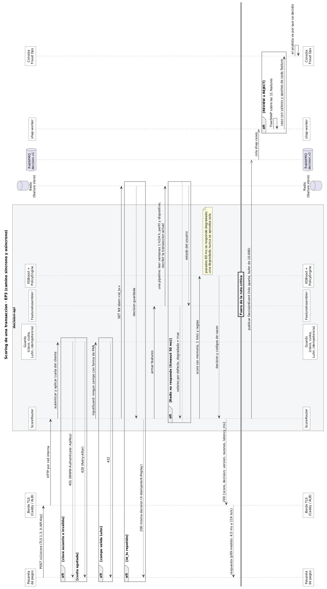
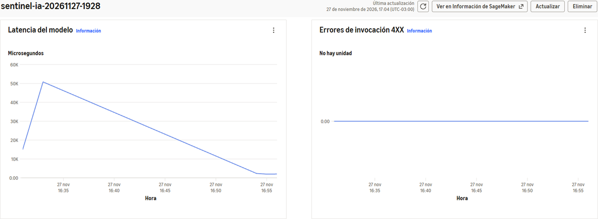
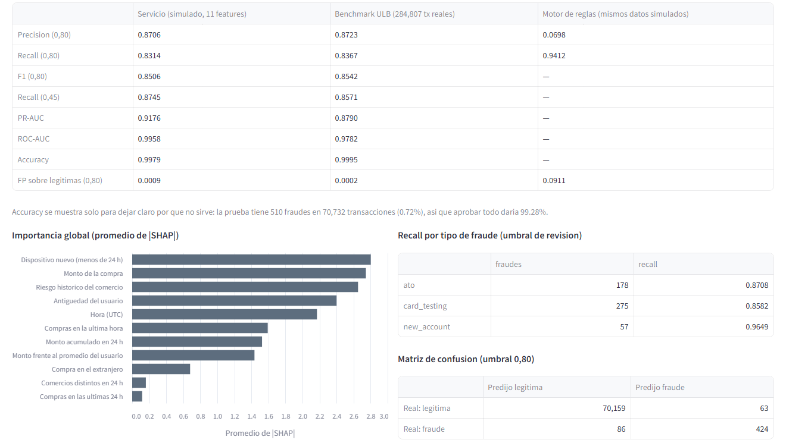

<!--
Fuente del informe tecnico de la EP3 (pauta: PDF de 10 paginas).
PDF: python scripts/generar_informe.py  (ver el docstring del script).
Las cifras salen de docs/RESULTADOS.md y de docs/evidencias/: si se vuelve a
medir, actualizar ambos. Lo que esta entre [COMPLETAR: ...] depende de AWS o
del equipo. Los datos de la portada se reemplazan desde
docs/informe/portada.local.json, que no se versiona.
-->

# SENTINEL-IA · Evaluación Parcial 3

**Proyecto integral de despliegue y optimización de un sistema de IA empresarial** · Caso 3: detección de fraude financiero

| | |
|---|---|
| Integrantes | [COMPLETAR: integrantes] |
| Asignatura | ITY1102 Arquitectura de Sistemas de Inteligencia Artificial |
| Docente y sección | [COMPLETAR: docente y sección] |
| Fecha | [COMPLETAR: fecha de entrega] |
| Repositorio | https://github.com/kuroishi-py/sentinel-ia |

## Correspondencia con la pauta

| Apartado de la pauta | Indicador | Sección |
|---|---|---|
| 1.1 y 2.1 Modelo: tipo, framework, entrenamiento, datos, hiperparámetros; despliegue; interpretabilidad; capturas | IE1, IE2 | 2 |
| 1.2 SageMaker, infraestructura, escalabilidad, costos y evidencias | IE4, IE5 | 1, 2.3, 4.2, 4.4, 5 y anexo de evidencias |
| 1.3 y 2.2 APIs, flujo entre componentes, seguridad, secuencia e interoperabilidad | IE7 | 3 |
| 2.3 Casos de prueba, rendimiento, carga, métricas del modelo, optimización | IE10 | 4 |
| Aspectos formales: README, Dockerfile, referencias APA, declaración de IA | — | Repositorio y final |

**Retroalimentación de entregas anteriores.** En la EP1 no hubo observaciones.

## 1. Qué se construyó

SENTINEL-IA califica cada transacción de la pasarela de pagos antes de autorizarla y responde aprobar, revisar o rechazar. Los casos dudosos llegan a Fraud Ops con su explicación. La EP2 fijó los objetivos que esta entrega mide:
- p99 bajo 100 ms en la pasarela y bajo 30 ms dentro del servicio (RNF1);
- 116 tx/s de pico (RNF4);
- explicación de cada rechazo (RNF5);
- menos falsos positivos que el motor de reglas actual (RNF7).

Los componentes son los de la EP2 (Figura 1). Todo se levanta con `docker compose up`, con el equivalente de cada pieza en AWS:

| Componente (EP2 §5) | Implementación EP3 | En AWS (EP2) |
|---|---|---|
| decision-api | FastAPI + XGBoost en memoria, gunicorn 2 workers | ECS Fargate |
| Feature store | Redis 7.4: perfil, ventanas 1 h/24 h, dispositivos, idempotencia | ElastiCache Valkey |
| Bus de eventos | RabbitMQ 3.13, exchange `decision.v1` | Kinesis |
| shap-worker | Consume `decision.v1`, TreeSHAP, crea el caso | ECS |
| Consola Fraud Ops | Streamlit | React + Nginx |
| Borde | Caddy, TLS 1.3 | NLB + ALB con mTLS |

## 2. Implementación y despliegue del modelo (2.1)

### 2.1 Tipo, framework y datos

Clasificador binario de gradient boosting, **XGBoost 2.1.3** (Chen y Guestrin, 2016), como decidió la EP2 (D1): sobre datos tabulares predice en menos de 1 ms en CPU y admite TreeSHAP exacto (Lundberg et al., 2020).

El dataset público con fraude real, *Credit Card Fraud* de la ULB (Dal Pozzolo et al., 2015), anonimiza sus features como componentes principales (`V1`-`V28`). Un modelo entrenado con ellas tiene métricas reales, pero no se puede servir, porque la pasarela no envía componentes principales. Además, su explicación («V14 aportó 0,31») no ayuda a decidir.

El equipo optó por **dos modelos** con roles distintos:

| | Modelo de servicio | Benchmark real |
|---|---|---|
| Rol | Responde `/v1/score` y se explica en la consola | Mide el algoritmo sobre fraude real |
| Datos | Historia simulada: 4.000 usuarios, 300 comercios, 70 días, 315.503 tx, 0,60% fraude | ULB: 284.807 tx, 0,17% fraude |
| Features | Las 11 del diseño, con nombre | `Amount`, `V1`-`V28` |
| Partición | Temporal: 21 días de referencia, 35 de entrenamiento y 14 de prueba | Estratificada 80/20 |

La historia simulada tiene tres patrones de fraude: toma de cuenta, prueba de tarjeta y cuenta nueva. También tiene comportamientos legítimos que se les parecen: viajes, cambio de celular, compras grandes y pasajes de montos chicos.

**La decisión clave es cómo se calculan las features.** El entrenamiento reproduce la historia por la **misma función que usa la API** (`compute_features`), sobre el mismo feature store en versión de memoria. Así, la *feature parity* (RT2) se cumple por construcción; su ausencia es una de las fallas silenciosas más comunes en producción (Sculley et al., 2015). La prueba CP-20b reproduce cada transacción por la ruta validada de la API y exige features idénticas.

### 2.2 Entrenamiento e hiperparámetros

- **Árboles:** `max_depth` 6, `eta` 0,1, `subsample` y `colsample_bytree` 0,8, `min_child_weight` 5, método `hist`.
- **Desbalance:** `scale_pos_weight` 166,1.
- **Parada temprana:** sobre los últimos 7 días de entrenamiento; resultado, 299 rondas.
- **Riesgo por comercio:** tasa de fraude con suavizado bayesiano, calculada solo con el período de referencia, para que la feature no filtre la etiqueta.
- **Restricciones monotónicas** (control contra evasión de la EP2, AML.T0015): más velocidad, más monto sobre el promedio, un dispositivo nuevo, una compra en el extranjero o un comercio riesgoso nunca bajan el score.
- **Artefacto:** se publica con su SHA-256; la API no carga uno alterado (CP-21).
- **Reproducibilidad:** con semilla fija, el modelo sale idéntico bit a bit en la misma plataforma.

### 2.3 Despliegue

El endpoint `POST /v1/score` corre detrás de un borde TLS 1.3 (`https://localhost:8443`). La API carga el modelo, verifica su SHA-256 y hace un *warm-up*. Recién entonces responde 200 en `/health/ready`, porque el balanceador de la EP2 (menos solicitudes pendientes) no admite *slow start*.

La imagen es multietapa sobre `python:3.12-slim`, con usuario sin privilegios y sin secretos. Los contenedores corren con raíz de solo lectura y `no-new-privileges`. El contrato OpenAPI 3.1 se publica en `/docs` (Figura 2).

**En AWS** (Learner Lab, `us-east-1`): una EC2 `t3.medium` con rol `LabRole` e IMDSv2 ejecuta el mismo `docker compose`, con TLS de Let's Encrypt en `https://api.54-221-53-160.sslip.io` y logs en CloudWatch (`/sentinel-ia/*`). Pasos en `docs/DESPLIEGUE_AWS.md`. El modelo también se publicó, sin reentrenar, en un endpoint Serverless de SageMaker; la configuración y la comparación de latencia están en la sección 4.2.

### 2.4 Integración en la aplicación empresarial e interpretabilidad

La API nunca devuelve la explicación a la pasarela; la EP2 lo prohíbe para dificultar la extracción del modelo. El camino es asíncrono: cada decisión se publica en RabbitMQ; shap-worker calcula TreeSHAP para revisiones y rechazos y crea el caso con el valor y el aporte de cada feature, y la consola lo muestra en el lenguaje del analista.

En la Figura 3, una toma de cuenta termina rechazada y la consola explica por qué: compra en el extranjero (+5,3), dispositivo visto por primera vez hace menos de 24 h (+4,3), comercio con 9,6% de fraude histórico (+2,6) y tres compras en la última hora, por 6,2 veces el promedio del usuario. La antigüedad del usuario empuja en contra. TreeSHAP es exacto: la suma del valor base y los aportes da el score (CP-22).

En la prueba de tarjeta (Figura 4), la primera sonda de $990 se aprueba, la segunda va a revisión y desde la tercera se rechaza. Lo que la delata es la velocidad (9 compras en la última hora), no el monto. Esa distinción se ganó corrigiendo un sesgo: la primera versión del simulador hacía que el modelo rechazara un pasaje de micro pagado desde un celular nuevo.

## 3. Integración de servicios (2.2)

### 3.1 Flujo de comunicación y diagrama de secuencia

La Figura 6, al final de esta sección, actualiza la secuencia de la EP2 (Figura 6 de ese informe) con lo implementado:

1. El borde termina TLS 1.3.
2. decision-api autentica la API key y aplica la cuota del cliente.
3. InputGuard rechaza cualquier campo con forma de número de tarjeta (Luhn).
4. La idempotencia (SET NX) devuelve la misma decisión para un `id_tx` repetido.
5. Una sola pipeline a Redis lee el estado del usuario y lo actualiza con la transacción actual.
6. XGBoost y la política deciden.

Fuera de la ruta crítica, el evento se publica desde un hilo aparte, con búfer de 10.000 eventos, y shap-worker lo consume.

Cada falla se degrada en vez de cortar pagos (EP2 §8.5):

| Falla | Respuesta del sistema |
|---|---|
| Redis no responde | Decisión degradada, que nunca se aprueba sola |
| Falla la idempotencia | La transacción se evalúa como nueva (CP-19). Antes devolvía 500: lo encontró la prueba de carga |
| RabbitMQ caído | El evento espera en el búfer |
| No hay modelo | Todo va a revisión humana |

Durante la carga de 116 tx/s, el exchange `decision.v1` registró 116 mensajes/s de entrada y de salida (Figura 5): 16.704 eventos publicados y 0 descartados.

### 3.2 API REST

| Endpoint | Uso | Acceso |
|---|---|---|
| `POST /v1/score` | Decisión sobre una transacción (RF1, RF2, RF3, RF9) | Pasarela, con API key |
| `GET /health/live`, `/health/ready` | Health checks del balanceador | Público |
| `GET /metrics`, `/v1/stats` | Prometheus; p50, p95 y p99 para la consola | Solo red interna (404 en el borde) |
| `GET /docs`, `/openapi.json` | Swagger y contrato OpenAPI 3.1 | Público |

### 3.3 Seguridad

- **Autenticación.**
  - Cada cliente tiene una API key, enviada en `X-API-Key` y comparada en tiempo constante.
  - Sin clave válida, 401. Las claves viven en variables de entorno.
  - En AWS, la EP2 usa mTLS en el ALB y la identidad del certificado cumple el mismo papel.
- **TLS.**
  - El borde solo negocia TLS 1.3 (Rescorla, 2018) y rechaza 1.2.
  - Envía HSTS y `nosniff`, y oculta `Server`.
  - Su log de acceso borra la cabecera `X-Api-Key`: la primera versión la registraba en claro y se corrigió.
- **Rate limiting.**
  - Token bucket por cliente autenticado (200/s sostenidas, ráfaga de 400).
  - También hay cuota para quien no se autentica, así que probar claves tiene un límite.
  - Con 857 req/s ofrecidas por un cliente, la API respondió 26.357 veces 429 con `Retry-After` y ninguna vez 5xx.

Todo se verifica con `scripts/verificar_seguridad.py`: TLS 1.3 negociado y 1.2 rechazado, 401 sin clave, HSTS presente y `/metrics` oculto.

### 3.4 Pruebas de interoperabilidad

CP-23 tiene seis pruebas que corren contra el sistema levantado, por el mismo camino que la pasarela, y las seis pasan: el borde negocia TLS 1.3 y rechaza 1.2; los endpoints de operación no se ven desde afuera; sin clave no se pasa; una toma de cuenta termina en un caso explicado, con las features de Redis; una compra normal no genera caso; y RabbitMQ tiene la cola enlazada y un consumidor activo.

## 4. Testing y calidad (2.3)

### 4.1 Casos de prueba

Son 24 casos (CP-01 a CP-23 y CP-20b) en 101 funciones: 95 unitarias y de integración, y 6 de punta a punta. Todas pasan y ruff no reporta hallazgos. La integración continua corre las 95 con un Redis real en cada cambio.

| Grupo | Casos | Qué verifican |
|---|---|---|
| Guardrails | CP-01 a CP-04 | Rechazo de PAN por Luhn, idempotencia, datos corruptos |
| Política | CP-05 a CP-08 | Umbrales, reglas que solo endurecen, degradadas a revisión, botón de pánico |
| Cuota | CP-09, CP-10, CP-17 | Token bucket por cliente, relleno, 429 con `Retry-After` |
| Features | CP-11, CP-20, CP-20b | Orden del vector, ventanas, paridad Redis/memoria y entrenamiento/servicio |
| API | CP-13 a CP-16 | Contrato, PAN en caliente, idempotencia, health y métricas |
| Seguridad y resiliencia | CP-18, CP-19 | API key, fuerza bruta con cuota, Redis caído sin 500 |
| Modelo | CP-21, CP-22 | Artefacto aprobado, comportamiento, monotonía, SHAP exacto |
| Interoperabilidad | CP-23 | TLS → API → Redis → RabbitMQ → worker → caso |

### 4.2 Rendimiento a 116 tx/s

Cómo se midió:
- 3 minutos de carga dentro de la red de Docker y contra la tarea, como el balanceador.
- Antes, la historia de 20.000 usuarios se precarga en Redis; sin ella, cada solicitud parece una cuenta nueva y no representa el pico real.
- La VM de Docker tiene 2 vCPU compartidas, así que las cifras son un piso.

| Medición | Solicitudes | Throughput | p50 | p95 | p99 | Errores |
|---|---|---|---|---|---|---|
| k6, llegada constante | 20.881 | 116,0 req/s | 1,84 ms | 2,63 ms | **4,51 ms** | 0% |
| Servidor, solicitud completa | — | — | 1,56 ms | 2,22 ms | **3,57 ms** | — |
| Sonda propia, 116 conexiones | 2.900 | 116 req/s | 1,8 ms | 3,4 ms | 5,3 ms | 0% |
| Locust (`FastHttpUser`) | 20.600 | 115,0 req/s | 44 ms | 88 ms | 120 ms | 0% |

**Los tres objetivos de la EP2 se cumplen con amplio margen:** p99 en la pasarela < 100 ms, p99 interno < 30 ms y errores < 1%. Además, no hubo decisiones degradadas y el 99,4% fueron aprobaciones.

Locust se aparta de los otros tres clientes, que coinciden en 2 a 5 ms. Una sonda propia con el mismo patrón de conexiones (116, a 1 solicitud por segundo) mide 1,8 ms, así que el sobrecosto es del cliente de Locust en esta VM, no del servicio. Se reporta porque la pauta lo nombra.

**Hallazgo para el contrato con la pasarela.** Un cliente que envía cabeceras y cuerpo del POST en dos escrituras sin `TCP_NODELAY` suma 40 ms fijos: 44,7 ms contra 3,0 ms. Es el algoritmo de Nagle esperando el ACK que Linux retarda. El servidor ya usa `TCP_NODELAY`; la pasarela debe usar un cliente HTTP que también lo haga.

**En AWS: modelo en la API frente a SageMaker (decisión D2).** El mismo `model.json`, verificado por SHA-256, se publicó en el endpoint Serverless `sentinel-ia-20261127-1928` (contenedor XGBoost 1.7-1, 2 GB, hasta 20 invocaciones simultáneas y escala a cero; Figura 7), que devolvió el mismo score que la API en tres escenarios. Carga de k6 a 116 tx/s durante 2 minutos desde la EC2, cambiando solo `SCORER_BACKEND`:

| Backend | Solicitudes | p50 | p95 | p99 | Errores | Degradadas |
|---|---|---|---|---|---|---|
| Modelo en la API (D2) | 13.921 | 3,16 ms | 8,42 ms | **28,19 ms** | 0% | 0 |
| Endpoint de SageMaker | 13.921 | 42,74 ms | 255,08 ms | **659,72 ms** | 0% | 2.946 (21%) |

Con el modelo en la API, los objetivos se cumplen también en AWS (CPU de la instancia: 25 a 30%). Con el endpoint, el p99 sube a 660 ms y el 21% sale degradado a revisión por el corte de 60 ms, aunque el modelo tarda unos 2 ms (`ModelLatency`) y no hubo errores: el resto es red y sobrecarga. **La medición confirma D2:** el endpoint sirve para lotes y evaluación en sombra, no para la ruta del pago.

### 4.3 Métricas del modelo

Sobre los 14 días de prueba, que el modelo nunca vio: 70.732 transacciones, 510 fraudes.

| | Precision | Recall | F1 | PR-AUC | FP sobre legítimas |
|---|---|---|---|---|---|
| Modelo, rechazo (0,80) | 0,871 | 0,831 | 0,851 | 0,918 | 0,09% (63) |
| Modelo, revisión (0,45) | 0,796 | 0,875 | 0,834 | 0,918 | 0,16% (114) |
| Motor de reglas, mismos datos | 0,070 | 0,941 | — | — | 9,1% (6.396) |
| Benchmark ULB (real), 0,80 | 0,872 | 0,837 | 0,854 | 0,879 | 0,02% (12) |

Notas de lectura:
- **Accuracy (0,998) no se usa:** aprobar todo daría 0,993. Por eso se reportan precision, recall y PR-AUC, más informativa que ROC con clases desbalanceadas (Saito y Rehmsmeier, 2015).
- **Contra el motor de reglas:** de cada 100 alertas, el motor tiene 93 falsas y el modelo 13. El costo es recall (0,83 contra 0,94 al rechazo); el umbral de revisión recupera 0,875 con un analista en el medio.
- **Por tipo de fraude** (umbral 0,45): cuenta nueva 0,965, toma de cuenta 0,871 y prueba de tarjeta 0,858.
- **Benchmark real:** el mismo algoritmo obtiene precision y recall del mismo orden sobre fraude real, lo que respalda que el resultado no es un artefacto de la simulación.

### 4.4 Escalabilidad: capacidad por tarea

La EP2 supuso 120 solicitudes/s por tarea de 1 vCPU, «a validar en prueba de carga». Se midió limitando el contenedor con k6:

| CPU de la tarea | 39 tx/s | 58 tx/s | 120 tx/s | 250 tx/s | 375 tx/s | 500 tx/s |
|---|---|---|---|---|---|---|
| 1 vCPU, p99 | — | — | 5,2 ms | 7,0 ms | **25,4 ms** | 64 ms |
| 0,5 vCPU, p99 | **22,5 ms** | **24,2 ms** | 39,9 ms (116 tx/s) | 60,8 ms (200 tx/s) | — | — |

- **Una tarea de 1 vCPU sostiene ~375 solicitudes/s con p99 < 30 ms:** tres veces lo supuesto.
- **Una de 0,5 vCPU cumple los dos escenarios del diseño:** el pico repartido en tres zonas (39 tx/s) y el pico con una zona caída (58 tx/s).
- **Memoria medida:** 284 MiB por tarea, contra los 0,45 GB por proceso supuestos.

### 4.5 Hallazgos y oportunidades de optimización

Las pruebas de carga, las de comportamiento del modelo y la revisión del código encontraron problemas que las unitarias no veían. Todos se corrigieron, y la mayoría quedó cubierta por un caso:

| Problema | Corrección |
|---|---|
| Redis lento devolvía 500 | Ahora degrada (CP-19) |
| XGBoost abría un hilo OpenMP por núcleo en cada predicción: p99 interno de 62 ms | Un hilo por proceso: 3,5 ms |
| El script de carga original generaba ~730 req/s llamándolas «el pico» y contaba los 429 como éxito | Perfiles `pico` y `capacidad` |
| El modelo rechazaba pasajes de micro | Se corrigió el simulador |
| La API key quedaba en el log del borde | Filtro en el log |

Riesgo vigente: un `id_tx` numérico de 13 a 19 dígitos tiene ~10% de probabilidad de pasar Luhn y rechazarse. El contrato con la pasarela debe fijar identificadores no numéricos.

Optimizaciones propuestas:
1. Tareas de 0,5 vCPU (sección 5).
2. Subir el objetivo de escalado de 40 a ~120 req/s por vCPU.
3. Cuota compartida en Redis o WAF: hoy el token bucket es por proceso.
4. SHAP por lotes.
5. Revisar el umbral de rechazo: pasar de 0,80 a 0,90 evita 18 de 63 falsos positivos a cambio de 10 de 510 fraudes, con F1 casi igual.

## 5. Costos

La estimación de la EP2 (Anexo F, AWS Pricing Calculator, sa-east-1) es de USD 1.982/mes para 1.000.000 tx/día: 4,8% del fraude anual que el caso busca contener. Las mediciones permiten bajar la partida de decision-api. Del mismo anexo: una tarea ARM de 1 vCPU/2 GB cuesta USD 49,60 al mes, y una de 0,5 vCPU/1 GB, USD 24,80.

| Opción para decision-api | USD/mes | Ahorro | Respaldo |
|---|---|---|---|
| EP2: 3,5 tareas de 1 vCPU/2 GB en promedio | 173,59 | — | Supuesto de 120 req/s por tarea |
| 3 tareas de 1 vCPU/2 GB, sin escalar | 148,79 | 24,80 | El pico usa un tercio de la capacidad medida |
| **3 tareas de 0,5 vCPU/1 GB** | **74,40** | **99,19 (57%)** | p99 de 22,5 ms normal y 24,2 ms con una zona caída |

La tercera opción ahorra USD 1.190 al año, el 5% del total. Antes de adoptarla hay que repetir la medición en Fargate ARM, porque el margen frente a los 30 ms es de ~20%.

**Costo de la demostración en AWS:** USD 0,03 al 27-11-2026 según *Costo y uso* (EC2, red y CloudWatch; la facturación tiene hasta 24 h de desfase). El endpoint serverless solo cobra mientras procesa invocaciones.

## 6. Conclusiones

- **El diseño de la EP2 cumple sus objetivos medidos.** Servir el modelo en memoria (D2) deja el p99 en 4,5 ms frente a 100 ms de presupuesto. El 99,4% de las decisiones se aprueban sin fricción, y una explicación acompaña cada revisión o rechazo.
- **La interpretabilidad depende del contrato de features más que del modelo.** Separar el modelo que se sirve del benchmark permite explicar decisiones en términos que un analista usa, sin renunciar a una validación con fraude real. Calcular las features con el mismo código en entrenamiento y servicio elimina la fuente más común de error silencioso.
- **Medir cambió decisiones.** La capacidad real triplica la supuesta y permite reducir a la mitad el costo de la API. Las pruebas de carga, las de comportamiento y la revisión de logs encontraron cinco defectos que las unitarias no veían, entre ellos un 500 bajo falla de Redis y una API key en los logs. También dejaron dos condiciones para el contrato con la pasarela: identificadores no numéricos y `TCP_NODELAY`.
- **SageMaker confirmó D2 con datos:** el mismo modelo en el endpoint sube el p99 de 28 a 660 ms y deja el 21% de los pagos en revisión, aunque el modelo tarda 2 ms. SageMaker queda para lotes y evaluación en sombra.

## Referencias

Chen, T., & Guestrin, C. (2016). XGBoost: A scalable tree boosting system. En *Proceedings of the 22nd ACM SIGKDD International Conference on Knowledge Discovery and Data Mining* (pp. 785-794). https://doi.org/10.1145/2939672.2939785

Dal Pozzolo, A., Caelen, O., Johnson, R. A., & Bontempi, G. (2015). Calibrating probability with undersampling for unbalanced classification. En *2015 IEEE Symposium Series on Computational Intelligence* (pp. 159-166). IEEE. https://doi.org/10.1109/SSCI.2015.33

Lundberg, S. M., Erion, G., Chen, H., DeGrave, A., Prutkin, J. M., Nair, B., Katz, R., Himmelfarb, J., Bansal, N., & Lee, S.-I. (2020). From local explanations to global understanding with explainable AI for trees. *Nature Machine Intelligence, 2*(1), 56-67. https://doi.org/10.1038/s42256-019-0138-9

Rescorla, E. (2018). *The Transport Layer Security (TLS) protocol version 1.3* (RFC 8446). Internet Engineering Task Force. https://doi.org/10.17487/RFC8446

Saito, T., & Rehmsmeier, M. (2015). The precision-recall plot is more informative than the ROC plot when evaluating binary classifiers on imbalanced datasets. *PLOS ONE, 10*(3), e0118432. https://doi.org/10.1371/journal.pone.0118432

Sculley, D., Holt, G., Golovin, D., Davydov, E., Phillips, T., Ebner, D., Chaudhary, V., Young, M., Crespo, J.-F., & Dennison, D. (2015). Hidden technical debt in machine learning systems. En *Advances in Neural Information Processing Systems 28* (pp. 2503-2511).

## Declaración de uso de IA generativa

Se utilizó Claude (Anthropic) para:
- revisar el repositorio frente a la pauta de la EP3;
- implementar el simulador de transacciones, el cálculo de features compartido entre entrenamiento y servicio, la autenticación, el borde TLS y las pruebas;
- ejecutar y diagnosticar las pruebas de carga;
- preparar el despliegue en AWS Academy (endpoint de SageMaker, EC2 y CloudWatch) con scripts que el equipo ejecutó en el laboratorio;
- redactar borradores de la documentación y de este informe.

Las decisiones de diseño provienen de la EP1 y la EP2 del equipo. Las cifras fueron medidas en el sistema y están respaldadas por los archivos de `docs/evidencias/` del repositorio. El equipo revisó y validó el contenido final.
